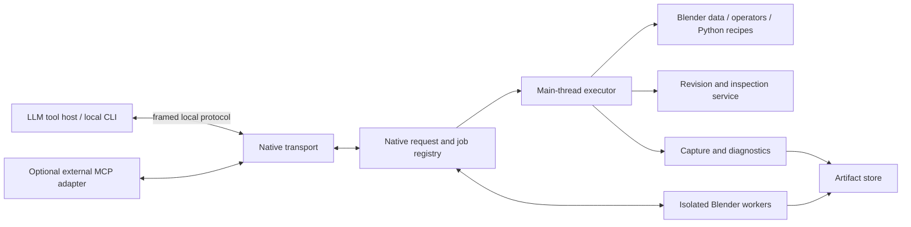

# Native Blender Agent Bridge: design and initial specification

**Status:** design baseline with a tested initial Linux implementation. See
[implementation status and evidence](native_llm_bridge_progress.md) for tested functionality and gaps.

**Target:** this Blender source checkout, initially the local Linux/system-dependency build on
branch `mine`. The inspected source baseline is `0d5ea459e3b`. Names, limits and interfaces marked
proposed below are design decisions for review, not existing Blender APIs or performance results.

## 1. Purpose and scope

Implement a native service, active by default with an explicit opt-out, through which an external LLM tool host can inspect, edit and
review an existing Blender session. Blender owns scene access, scheduling, identity, job state and
capture. The external host owns the conversation, model calls and task authorization.

The service is compiled into Blender; it requires no add-on, extension installation or separate MCP
server. Its UI may use Blender's normal built-in Python UI modules. Existing modelling recipes
remain Python code using `bpy`, `bmesh` and Blender's mesh, modifier, node and rendering facilities.
An optional external MCP adapter can translate tool calls to the same native interface later.

The first implementation should provide:

- A persistent local connection to the user's normal Blender session and a native status UI.
- Explicit context, stable session handles, scene revisions and bounded incremental inspection.
- Identified, retry-safe jobs with structured results, progress, cancellation and artifacts.
- Versioned recipe execution and a deliberately trusted workspace-script escape hatch.
- Separate guarantees for small live edits, staged structural edits and background work.
- Matched visual captures accompanied by numerical checks and construction provenance.

The primary efficiency objective is fewer agent round trips and less repeated inspection, code
transfer, rebuilding and rendering per successful edit. Transport and native-code speedups must be
measured. Replacing MCP or JSON alone does not establish an end-to-end improvement.

### Non-goals for the initial implementation

- An LLM, provider account, API key or automatic model download embedded in Blender.
- A new modelling kernel, a universal building generator or hard-coded Eternity Forge objects.
- A general security sandbox for Python, universal rollback or interruption of every operator.
- Internet-facing access, collaborative multi-writer editing or Windows/macOS transport parity.
- Treating a successful command, closed mesh or image-fit score as artistic acceptance.

## 2. Architecture and ownership



The native service is the authority for accepted requests, jobs and results. A client must not need
an additional coordinator process to keep a job alive. A persistent Python client library and CLI
are conveniences over this interface; an MCP adapter must not acquire a second job/state model.

Transport threads handle framing, authentication and immutable messages only. They never traverse
`Main`, use RNA, acquire Python objects, evaluate the dependency graph or access GPU/UI state.
Blender-side reads and writes are scheduled on the main thread unless a specific existing native
operation has an audited worker-thread contract. Parallel workers receive snapshots, not pointers
into the live session.

## 3. Native integration plan

The following are existing integration anchors verified in this checkout:

| Existing source | Intended use / constraint |
| --- | --- |
| [WM API](../source/blender/windowmanager/WM_api.hh) | Timers, operators and job integration. |
| [WM event loop](../source/blender/windowmanager/intern/wm_event_system.cc) | Main-thread dispatch and notifications. `WM_main_add_notifier()` traverses live WM data; it must not be assumed thread-safe. |
| [WM initialization/exit](../source/blender/windowmanager/intern/wm_init_exit.cc) | Start after initialization; stop transport and jobs before dependent data is freed. |
| [WM jobs](../source/blender/windowmanager/intern/wm_jobs.cc) and [status types](../source/blender/windowmanager/WM_types.hh) | Progress and cooperative stop integration. `WM_jobs_*` does not authorize arbitrary `bpy` access from a worker. |
| [WM runtime](../source/blender/blenkernel/BKE_wm_runtime.hh) | Runtime ownership/lifecycle; avoid serializing service state into `.blend` data. |
| [ID definition](../source/blender/makesdna/DNA_ID.h) | `ID.session_uid` identifies an ID across potential reallocations, including undo/redo; it is not a cross-process identity. |
| [Dependency-graph queries](../source/blender/depsgraph/DEG_depsgraph_query.hh) | Dirty-state/evaluation integration; distinguish original and evaluated IDs. |
| [Message bus](../source/blender/windowmanager/message_bus/wm_message_bus.hh) and [Python limitations](python_api/examples/bpy.msgbus.1.py) | Property notifications complement other change detection; message bus alone misses viewport transforms and animation updates. |
| [Undo interface](../source/blender/editors/include/ED_undo.hh) | Scoped synchronous apply operators; do not hold an undo group open across asynchronous jobs or artist interaction. |
| [Python module registration](../source/blender/python/intern/bpy.cc) | Add proposed `bpy.agent_bridge` bindings to the compiled service. |
| [Viewport API](../source/blender/editors/include/ED_view3d.hh) | Explicit capture context and offscreen/view-dependent drawing integration. |
| [JSON serialization](../source/blender/blenlib/BLI_serialize.hh) | Reuse Blender facilities before introducing a protocol serialization dependency. |

Proposed new code organization:

```text
source/blender/agent_bridge/                 protocol, jobs, revisions, artifacts, registry
source/blender/windowmanager/intern/wm_agent_bridge.cc
                                             WM lifecycle, dispatch and apply operators
source/blender/python/intern/bpy_agent_bridge.cc
                                             bindings and Python recipe adapter
scripts/modules/bl_agent/                    thin client/recipe helpers where appropriate
tests/python/agent_bridge/                   Python/API integration fixtures
```

These paths are proposals. Keep the protocol/job core independent of editor and Python libraries;
WM/editor/Python adapters depend on that core. Review the library dependency graph before adding
links so the new module does not introduce circular dependencies.

`WITH_AGENT_BRIDGE` defaults ON for Linux builds with embedded Python and OFF for unsupported profiles.
Require embedded Python for recipe support. Avoid a new DNA/UserDef field in the MVP by keeping
endpoint configuration and enablement runtime-only. A later persistent preference needs normal
versioning and review. No asset repository is a Blender build dependency.

## 4. Startup, transport and local trust

### Lifecycle

- Normal Blender startup keeps the user's preferences and other add-ons intact.
- Application startup enables the service after window-manager initialization in GUI/background
  mode. `--disable-agent-bridge` opts out; `--agent-bridge` opts back in. The last startup flag wins.
  Native Start/Stop operators remain available. A loaded `.blend` must not restart a stopped service.
- Initialization is deferred until the window manager is ready. The status UI displays connection
  state, file/scene, active jobs, pending edits and capture/results links, with Cancel and Revert
  actions where supported.
- Stop rejects new requests, resolves queued work, requests cooperative cancellation and joins
  transport threads. Shutdown must not leave a thread holding a Blender or Python pointer.
- Private workers explicitly opt out and must not depend on a viewport or expose another listener.
  Ordinary background launches follow the default startup policy and retain their normal lifetime.

### Initial wire binding

Use a Unix-domain socket in a private per-process runtime directory. Do not add a TCP listener in
the MVP. Directory mode is 0700; socket and session descriptor access are restricted to the user.
Verify peer credentials and require a random per-launch session token obtained from the private
descriptor. The token must not appear in process arguments, normal logs or project files. This is
a trusted local-user interface, not isolation from other processes running as that same user.

Use JSON-RPC 2.0 envelopes over a 4-byte unsigned big-endian byte-length prefix followed by UTF-8
JSON. This is a native binding, not MCP framing. Parse partial reads, multiple buffered frames and
UTF-8 boundaries correctly; match responses by request ID rather than stream ordering.

Provisional defaults to test: 8 MiB maximum frame, eight outstanding requests per client, 64 KiB
default inspection/report budget and 1 MiB maximum artifact-read chunk. Reject oversized frames
before allocating their declared payload. Queues, event retention, disk artifacts and result
caches need configurable bounds and backpressure. Return an explicit truncation marker or busy
error instead of silently dropping state.

## 5. Session, context and identity

`bridge.hello` negotiates protocol major/minor versions and returns:

- Blender version, build hash, bridge version and supported methods/features.
- A process `session_id`, current `scene_epoch`, current scene revision and permissions.
- Current file/scene/view-layer information and whether undo/capture/worker execution is available.

Authentication precedes inspection. Incompatible protocol majors are rejected; unsupported
optional features are reported explicitly. Reconnection to the same process retains its job IDs.

Object handles combine the session, epoch and original `ID.session_uid`, plus an ID-type check.
Never transmit pointers or retain evaluated IDs as long-lived handles. Resolve handles immediately
before use. Deleted IDs yield `STALE_HANDLE`; names are labels, not identity.

Advance the epoch on file replacement and conservatively on undo/redo or context reconstruction
until finer identity rules are proven. Existing asset/module keys may provide persistent semantic
identity. Assigning new persistent UUIDs is an explicit authoring operation: an inspection request
must not write custom properties or dirty the file. Linked data stays read-only unless an explicit
supported override/localization operation is requested.

Every scene operation supplies a context selector: scene, view layer, target handles and, when
required, window/area/mode. Re-resolve UI handles; never assume the currently active editor or
selection. Prefer explicit datablock APIs over context-sensitive operators. Restore temporary
selection, camera and editor changes when the operation's contract permits it.

## 6. Revisions and incremental inspection

Maintain a monotonic scene revision with dirty categories for topology, transforms, modifiers,
materials, images, animation, collections, cameras and context. Coalesce repeated updates. Use
native change notifications, dependency-graph updates and file/undo lifecycle hooks together.
Callbacks record dirtiness; expensive summaries, hashes and captures run later on the main thread.

`scene.inspect` returns a bounded snapshot with units, frame, bounds, object/module summaries,
visibility, instance/material relationships and optional evaluated counts. Geometry arrays and
full node graphs are opt-in artifacts rather than default LLM text.

`scene.changes` accepts an epoch/revision cursor. It returns changed/deleted handles and categories,
or `RESET_REQUIRED` if the cursor is stale or retained history has a gap. Keep model data, material
and camera revisions separate where possible so a paint change can reuse valid topology checks.

Notifications are an invalidation aid, not a complete proof that nothing changed. A mutation also
records and rechecks fingerprints of its declared read set: relevant geometry, transforms,
materials, collection membership and external resource hashes. The first version may reject on
any intervening scene revision. A later disjoint-edit optimization must preserve these checks.

## 7. Operation surface and request contract

The proposed small core surface is:

| Method | Contract |
| --- | --- |
| `bridge.hello`, `bridge.status`, `bridge.stop` | Negotiate/authenticate, report service state, request controlled shutdown. |
| `scene.inspect`, `scene.changes` | Bounded read-only snapshots and revision deltas. |
| `recipes.list`, `recipes.describe` | Discover versioned recipes and load detailed schemas only when needed. |
| `job.submit`, `job.status`, `job.cancel` | Accept an operation, return its ID promptly, query progress/results or request cancellation. |
| `job.wait` | Bounded asynchronous completion wait owned by the I/O service; never blocks Blender's main thread. |
| `job.apply`, `job.discard` | Apply or discard a prepared candidate with explicit preconditions. |
| `artifacts.list`, `artifacts.read` | Access bounded artifacts owned by the session/job. |
| `capture.pick` | Resolve a pixel through one captured ID map/table, returning that capture's pose and provenance. |
| `storage.stats`, `storage.prune` | Account for owned output/reservations; explicitly release eligible artifacts after dependency/ownership checks. |
| `history.sessions`, `history.job` | Compact interruption history and deliberate access to one job's private provenance; no implicit replay. |

Submitted operation types include recipe execution, trusted workspace-script execution, capture,
validation and checkpoint creation/restoration. Some are later milestones; `bridge.hello` must
advertise only what is implemented. Arbitrary RNA mutation/reflection is not an MVP interface.

All mutating submissions declare context, read/write scope, expected epoch/revision, an operation
key and apply mode. Coordinates declare local/world frame and units; inspect the scene's unit
settings rather than silently normalizing user data. Reject stale inputs before mutation.

Illustrative request; recipe name and parameter value are examples, not current APIs or an adopted
roof-thickness requirement:

```json
{
  "jsonrpc": "2.0",
  "id": "request-23",
  "method": "job.submit",
  "params": {
    "operation_key": "roof-edit-07",
    "session_id": "session-example",
    "scene_epoch": 3,
    "expected_revision": 42,
    "expected_fingerprint": "READ_SET_SHA256_HEX",
    "operation": "recipe.execute",
    "execution_mode": "worker_candidate",
    "apply_mode": "auto_if_valid",
    "context": {"scene": "scene-handle", "view_layer": "ViewLayer"},
    "scope": {"collection": "collection-handle", "module_key": "roof.main"},
    "recipe": {"id": "town.roof_section", "version": "1", "source_sha256": "SHA256_HEX"},
    "parameters": {"normal_thickness_m": 0.025},
    "checks": ["support_contacts", "section_thickness"],
    "captures": ["front", "oblique", "underside"]
  }
}
```

Acceptance returns `job_id`, state, accepted revision and an event cursor. The operation key is
scoped to the session and authenticated client identity: retrying the same key and payload returns
the same job/result. Reusing a key with different input returns `IDEMPOTENCY_CONFLICT`. A JSON-RPC
request ID alone is not an idempotency key. A client timeout or disconnect does not undo or repeat
an accepted job; clients reconnect and query it.

Use structured errors with a stable code, job ID when available, phase, retryability and concise
details. Initial errors include `UNAUTHORIZED`, `UNSUPPORTED_VERSION`, `INVALID_PARAMS`, `BUSY`,
`STALE_HANDLE`, `REVISION_CONFLICT`, `CONTEXT_UNAVAILABLE`, `RECIPE_CHANGED`, `VALIDATION_FAILED`,
`CANCELLED` and `INTERNAL_ERROR`. Do not require clients to parse printed exception strings.

## 8. Main-thread scheduling and workers

The I/O thread submits immutable requests to a bounded queue. A main-thread dispatcher validates
context and runs work units. Use a native BLI timer serviced by the WM event loop initially;
provisional active polling interval is 20 ms and dispatch budget is 4 ms between cooperative work
units. These are tuning defaults, not guarantees that an individual operator completes in 4 ms.

An event-driven WM/GHOST wakeup is a follow-up integration task after its cross-thread behavior is
verified or a dedicated safe wake primitive is added. Do not call `WM_main_add_notifier()` from the
transport thread based only on its name. No Python networking thread lives inside Blender.

Serialize live scene access, including queries. The coordinator may serve immutable cached job
state/artifact bytes concurrently. Native WM jobs may be used only through adapters that honor
their thread/data ownership rules; arbitrary Python runs on the main thread.

Use separate Blender processes for expensive snapshot-based builds, baking, renders and bulk
validation when isolation or responsiveness warrants it. Record executable/build hash, working
directory, input hashes, frame, seeds, settings, required add-ons and output ownership. Town
recipes run in their asset workspace. Workers never overwrite a selected master as an incidental
result. An isolated/factory worker profile is allowed only when its recipe requirements are met;
it must not replace or reset the normal GUI session's preferences.

## 9. Execution modes and recoverability

| Mode | Intended use | Guarantee / limitation |
| --- | --- | --- |
| `live` | Small synchronous edits to explicitly owned data. | Checkpoint as needed and apply through an undoable operator. Changes are immediately visible and can dirty the file. No universal rollback of arbitrary script side effects. |
| `worker_candidate` | Structural recipes, expensive changes and preservation-sensitive work. | Build and validate against a snapshot in a private worker. Import selected results only at apply time. Startup/snapshot overhead must be measured. |
| `native_candidate` (later) | Native operations that can compute previews in owned temporary buffers. | No live ID mutation until commit; requires an explicit implementation per operation. |

Do not make every cheap edit rebuild the whole scene in a worker. Equally, do not call a collection
inside the live `Main` an isolated transaction: artists could save it, recipes could mutate shared
datablocks and intermediate operations may alter undo state. Such interactive staging would need
a separate, honest contract and is not the default candidate path.

Managed candidate execution proceeds as follows:

1. Resolve targets and capture a bounded dependency snapshot/read-set signature.
2. Pin the recipe, parameters, resource versions and operation scope.
3. Build owned candidate data, validate it and generate the requested evidence.
4. Return a ready candidate in preview mode, or continue under authorized `auto_if_valid` mode.
5. On the main thread, recheck epoch, context, handles and read-set fingerprints.
6. Import/map the candidate IDs and replace only the owned collection or declared fields through
   one scoped apply operator. Preserve unrelated IDs, references and collection placement.
7. Return the actual changed-ID map, post-apply revision, checks and artifacts.

Candidate meshes/materials must not mutate shared source datablocks. ID mapping, external
references, name collisions and cleanup are part of the apply adapter. An import/apply failure
must report what was changed and offer the supported checkpoint recovery; it must not claim
ACID atomicity for an arbitrary ID graph or file I/O.

Do not hold `ED_undo_group_begin()` open while awaiting an external worker or user interaction.
Report undo availability and use a checkpoint when undo cannot cover the operation. Restoration
that would discard unsaved user work is refused by default. Explicit destructive requests remain
subject to the host/user's authorization policy. Preview/apply does not mandate a new approval
dialog for every agent action: authorized tasks may be applied automatically after checks pass.

## 10. Jobs, progress and cancellation

The state progression is:

```text
queued -> preparing -> running -> validating -> capturing -> ready -> applying -> succeeded
```

Preview jobs stop at `ready`; auto-apply jobs proceed after precondition checks. Stages that are
irrelevant to an operation may be skipped. `failed`, `cancelled`, `conflict` and `interrupted` are
explicit outcomes with a phase and retained diagnostic record. A ready candidate may be discarded.

Events carry monotonic sequence numbers, job/state, phase, completed/total units when meaningful,
an optional progress estimate and artifact IDs. Progress is not fabricated for unknown-duration
operations. Clients must handle event gaps through status/snapshot retrieval.

Cancellation first records `cancel_requested`. Cooperative code checks it between units; existing
native jobs use their supported stop adapters. A blocking Python/native call may not be safely
interrupted until it returns. A private worker can be terminated after a grace period. A cancelled
or stale candidate never applies. Stop only jobs owned by this bridge/job, not all render jobs
sharing a scene owner.

Maintain a bounded durable journal with accepted parameters, code/resource hashes, phase changes,
timings and result references. On Blender exit/crash, unfinished jobs become `interrupted` on the
next launch. Resume is supported only for recipes with an explicit checkpoint contract and
matching inputs; never restore stale in-memory pointers. No job is silently restarted as a new
mutation because its client timed out.

## 11. Python recipes and trusted scripts

Proposed `bpy.agent_bridge` exposes registration, status and operation submission to in-process
scripts without a socket round trip. It delegates to the same service and does not own a second
queue. Embedded Python remains the execution engine for current asset recipes.

A recipe descriptor contains its ID/version, source/dependency hashes, parameter/result schemas,
allowed execution modes, declared data scope, context requirements, supported checks/captures,
checkpoint/cancellation behavior and artifact types. Recipe schemas are loaded on demand.

A per-job context supplies resolved inputs, parameters, owned candidate/output locations,
progress/checkpoint/report helpers and cancellation state. Recipes calculate geometry from explicit
dimensions and host sockets. The core understands scheduling and ownership, not what a blacksmith
roof, infirmary wall substrate or cloth tear should look like.

Workspace-script execution uses an explicitly trusted source path and hash, with optional inline
code under a separate advertised capability. Return a serializable result and structured reports;
captured stdout is supplemental and bounded. Respect Blender script/auto-execution preferences.
Do not discover and execute arbitrary text blocks from a loaded `.blend` or hot-reload a recipe
while it has running jobs. Pin inputs and invalidate cached compiled code when hashes change.

Python namespaces/modules and file operations are not a security or transaction sandbox. The
service must describe that capability honestly and restrict routine managed edits by contract and
validation. Reuse existing town builders, capture helpers, source fingerprints and parameter checks
through a workspace adapter, without importing asset-specific rules into Blender core.

## 12. Capture, inspection evidence and artifacts

Capture requests specify scene/view layer, frame, camera/projection, resolution, shading or render
engine, lighting and requested passes. Associate each artifact with the actual evaluated revision,
camera/settings hash, build and job. Wait for required evaluation/drawing completion; do not label
an earlier viewport buffer as evidence for the new revision.

Support named front/back/side/oblique/underside views, attachment close-ups and provisional game-size
captures. Initial useful passes are beauty/clay and an object-ID map; depth/normals are later
capabilities. A pixel pick must reference a particular capture and map back through that capture's
ID table, rather than treating screen coordinates as permanent object identity.

Checks are operation/recipe-specific: topology, thickness, selected contacts, collision pairs,
UVs, normals, resource integrity and instance transforms as applicable. Report measured values,
thresholds, sampled coverage and limitations. Keep execution success, numerical validity, visual
findings and user acceptance separate.

Store large meshes, arrays, images, `.blend` candidates and reports as versioned artifacts outside
the language-model text stream. Use bounded summaries and thumbnails by default; provide actual
image content when the model performs visual review. An opaque artifact handle alone is not vision.
Resolve artifact IDs inside private job roots; validate workspace paths and symlink resolution.
Never accept an arbitrary client path as an unrestricted file-read endpoint.

Protected source files remain unchanged. Export/bake outputs are staged under new paths and
published deliberately after validation; the bridge does not overwrite them on successful tool
execution alone. Cleanup affects only owned, unreferenced job artifacts under the retention policy.

## 13. Town workflow examples and acceptance boundaries

| Workflow | Native bridge use | Required evidence |
| --- | --- | --- |
| Blacksmith roof section | One recipe rebuilds roof sections and dependent seats/fascia from shared dimensions and support frames. | Selected contact/thickness checks; front, oblique and underside captures; source-preservation report. |
| Infirmary torn canopy | Update the opening, hanging flap and shared attachment samples together, retaining shell thickness and UVs. | Root continuity, selected cloth/timber intersection tests, side/underside captures. An authored drape must not be labelled a simulation. |
| Damaged model | Derive a separate condition; geometry controls missing material/holes and recipes bind appropriate damage painting. | Changed-component scope, cut thickness, shard/hinge placements, unaffected-source hashes. |
| Game derivative | Submit separate low construction, UV, bake and export jobs against a frozen master. | Visibility-sampling limits, exported triangles/materials, UV coverage/gutters, normal basis and actual reimport images. |
| Orthographic review | Capture four views from one evaluated 3D construction and shared scale/cameras. | Recorded projection, framing and baseline, hidden-part visibility and revision match. |

The Scolar's Guild work so far consists of imagegen references and projected proxies in the asset
repository. A native capture feature must not describe those paintings as renders of an existing
modular master. Likewise, no bridge can infer physically correct construction simply from a
successful Python call; the recipes and review criteria must supply that knowledge.

## 14. Delivery stages and exit criteria

The stages below define the delivery target. The linked implementation status records partial
progress; no feature should be advertised until its tests pass.

1. **Native service and inspection:** optional build flag, default startup with explicit opt-out, private local transport,
   framing/authentication, request IDs, hello/status, explicit context, original-ID handles and
   bounded inspection. Normal add-ons/preferences remain intact. Stop/reconnect/exit are exercised.
2. **Tracked live operations:** recipe/script adapter, operation keys, jobs/status/events, explicit
   revision/read-set preconditions, short scoped apply operators and structured failures. Use small
   synthetic scene fixtures before a protected town asset.
3. **Evidence and staged workers:** capture/artifact API, worker snapshots, candidate apply/discard,
   checkpoints, cancellation and source-preserving import. Exercise the roof-section workflow in an
   isolated copy of the asset workspace, then the canopy and runtime cases.
4. **Incremental efficiency:** delta inspection, cached schemas/metrics, dependency-aware rebuilds,
   bulk artifacts and optional worker reuse. Add an event-driven wake path or specialized C++ hot
   operation only after measurement supports it. Optional MCP adapter and other platforms follow.

Measure total time per successful change, tool/model round trips, request/artifact bytes, model
context size, preparation/build/evaluation/capture time, maximum GUI stalls, recovery time and
wrong/stale/duplicate mutations. Include setup and bridge development cost in workflow comparisons.
Compare equivalent output quality and checks; a faster invalid roof is not a successful result.

## 15. Test and validation specification

Acceptance tests below define the target; the implementation status names the current runnable tests:

- **Build/lifecycle:** feature-OFF build remains normal; feature-ON starts by default and honors opt-out;
  normal startup preserves preferences/add-ons; file load cannot enable the service; clean exit.
- **Transport:** partial/combined frames, malformed UTF-8/JSON, lengths/limits, slow clients,
  authentication/peer credentials, backpressure and response correlation. Secrets never enter logs.
- **Jobs:** retries return the same accepted job; mismatched operation keys fail; disconnects and
  timeouts do not duplicate work; cancellation/interrupt/resume report truthful states.
- **Scene access:** no Blender/Python/GPU access from the I/O thread; blocked/modal/unsupported
  contexts report explicit status; queries do not dirty the file; main-thread work is serialized.
- **Identity/revisions:** rename, delete, duplicate, instances, linked data, viewport transforms,
  animation, undo/redo and file replacement invalidate or preserve handles according to contract.
  Missed-notification cases are caught by read-set validation before apply.
- **Ownership/recovery:** shared mesh/material copies preserve source IDs; ready candidates never
  apply after conflicts/cancellation; import failure reports partial effects; undo/checkpoint tests
  cover supported operations; unsaved unrelated work is preserved.
- **Capture:** fixed camera/scale, current evaluated revision, ID-pick correspondence, no unintended
  material/camera/selection changes and graceful operation without a suitable viewport.
- **Artifacts:** path/symlink boundaries, immutable input hashes, bounded report/buffer sizes,
  interrupted writes, retention and independent reopen/reimport of produced `.blend`/GLB files.

Use small repository fixtures for native and Python tests. Optional real-town regression adapters
live in the asset workspace; do not copy the full asset history into Blender's core test suite.
Follow the local build profile and at most eight build jobs/two heavy compile jobs documented in
[the build guide](building_system_linux.md). Documentation changes alone need no Blender rebuild.

## 16. Open implementation decisions

- Exact WM/GHOST thread-safe wake mechanism and whether the initial WM timer is sufficient.
- Minimum native operation set, public naming and the `bpy.agent_bridge` registration surface.
- Snapshot dependency closure, candidate ID/reference mapping and which operations support one
  reliable undo step. Prototype these before claiming general transaction semantics.
- Revision coverage for all edit modes and a trustworthy, economical read-set fingerprint format.
- Worker startup/snapshot cost versus direct live edits; GPU scheduling alongside the user's work.
- Persistent configuration/versioning, multi-client ownership policy and non-Linux transports.

Resolve these with narrow prototypes and evidence. Keep unresolved capabilities absent from the
hello response, preserve failed examples and distinguish design completion from implementation.
